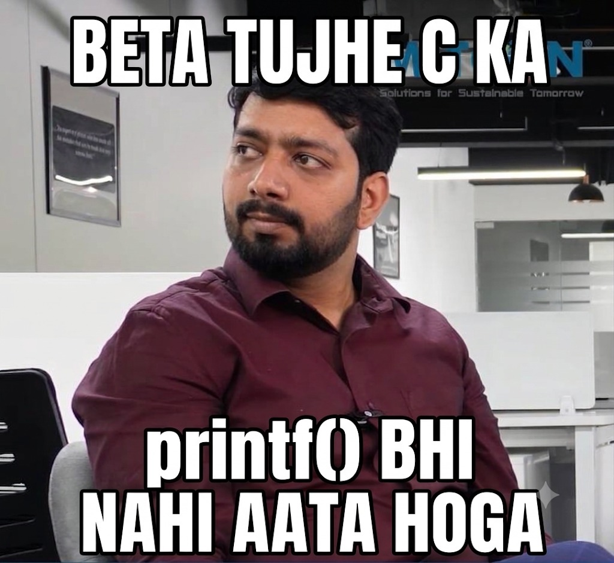
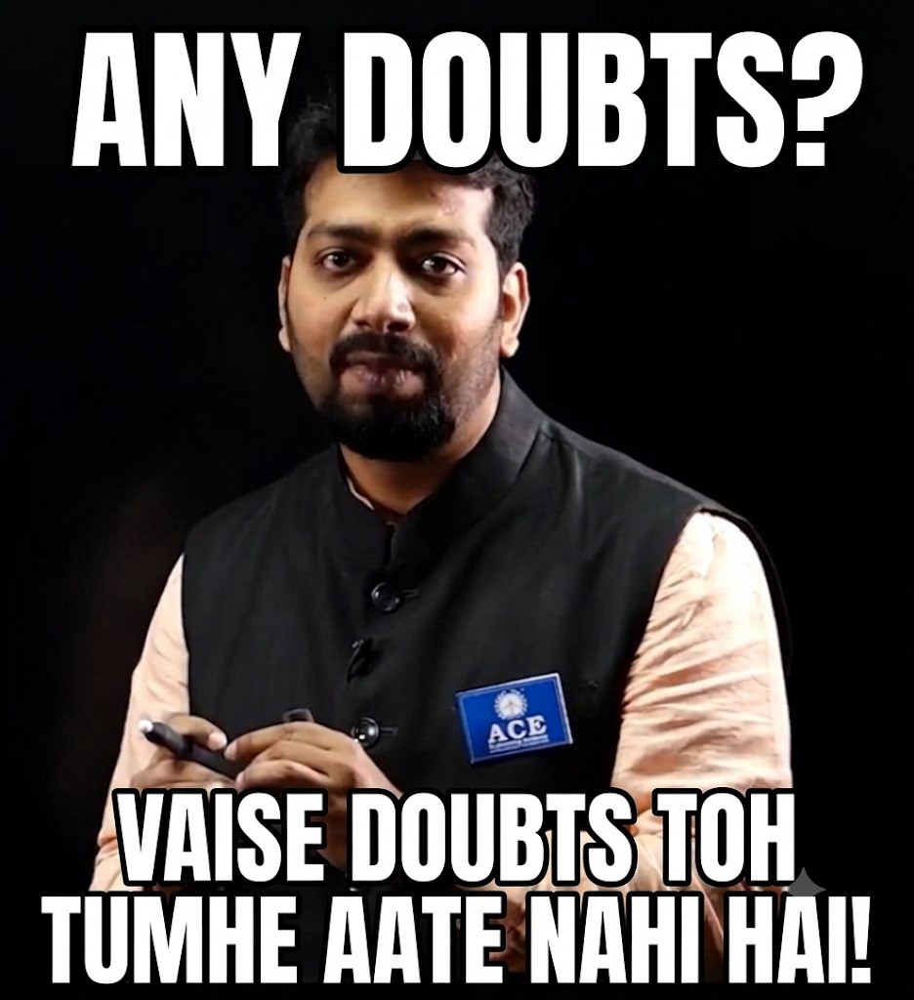
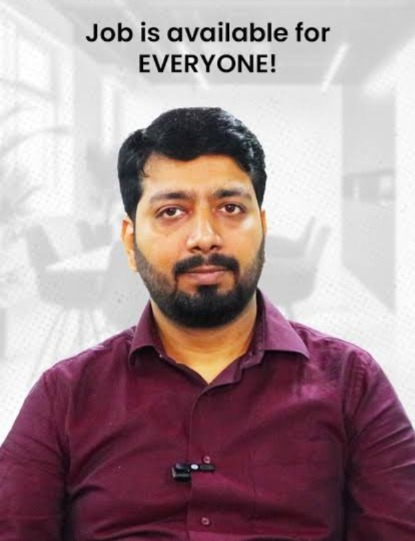
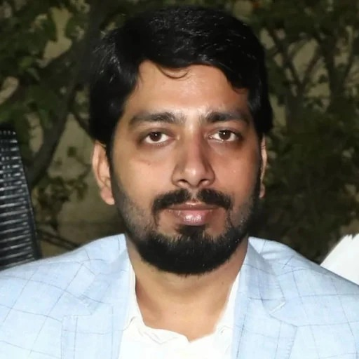
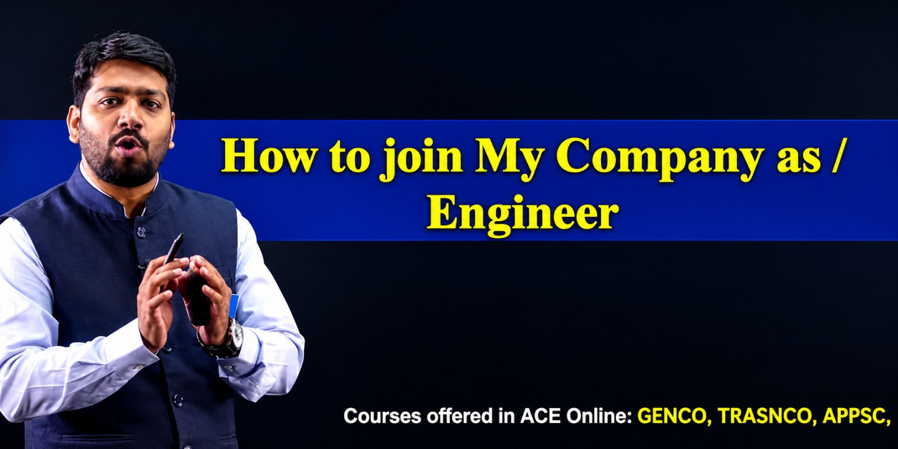

# 🎓 Prof. Viomesh Singh — Farewell & Startup Tribute 🚀

> *"Not retiring — just leveling up from shaping engineers in lecture halls to building the future as a Founder & CEO."*

### 🌐 Live Production Website: [https://viomesh-sir-farewell.vercel.app](https://viomesh-sir-farewell.vercel.app)

An interactive archival tribute and self-balancing AVL photo tree celebrating **Prof. Viomesh Singh**'s mentorship, iconic lectures, and his next chapter launching his startup company.

---

## 📸 The 8 Photo Memories (AVL Nodes)

| Node & Key | Photo Preview | Story & Complexity |
| :---: | :---: | :--- |
| **Node #10** |  | **"Beta Tujhe C Ka printf() Bhi Nahi Aata"**<br>`O(1) Reality Check` — Day 1 freshman reality check and C pointers. |
| **Node #20** |  | **"Recursion With Viomesh Sir"**<br>`O(2^n) Call Stack` — Whiteboard call stacks and divide-and-conquer dry runs. |
| **Node #30** |  | **"Any Doubts? Vaise Aate Toh Hai Nahi!"**<br>`O(0) Doubts` — The classic classroom banter that got 120 shy engineers asking questions. |
| **Node #40** |  | **"Job Is Available For EVERYONE!"**<br>`O(n) Offers` — Placement season motivation and cracking coding rounds. |
| **Node #50** |  | **"Dijkstra's Shortest Path to Chai"**<br>`O(1) Energy` — Sunglasses, mountain trails, and finding the optimal chai spot. |
| **Node #60** |  | **"The Whiteboard Architect"**<br>`O(log n) Master` — Faculty cabin discussions and deep algorithmic mastery. |
| **Node #70** |  | **"How To Join My Company As Engineer"**<br>`O(E + V) Network` — Keynote slide announcing the leap from academia to startup builder. |
| **Node #80** |  | **"new Startup('Viomesh Ventures') — Founder & CEO"**<br>`Valuation -> ∞` — Suit and tie executive portrait leveling up to Founder & CEO. |

---

## ✨ Features

- 🎬 **Cinematic Intro Video**: Edge-to-edge unmuted popup experience with smooth transition to the tribute portal.
- 🌳 **Dynamic Self-Balancing AVL Photo Tree**:
  - Step-by-step interactive construction of an 8-node AVL tree.
  - Strict left-bottom-most attachment with realistic 2-phase AVL balancing animations (Imbalance detection $\to$ LL Right Rotations).
  - Smooth pan-and-zoom viewport with dynamic zoom scaling.
  - 8 real photo memories tracking his journey from C fundamentals to Founder & CEO.
- 🖼️ **Full-Size Memory Detail Overlay**:
  - High-resolution, uncropped view of each photo memory.
  - Instant aspect ratio toggle (`FULL SIZE (ADAPTED)` ↔ `NATURAL FIT`).
  - Interactive student farewell notes wall and quotes.
- 💻 **LeetCode: Founder IDE**:
  - Interactive code editor loaded with Problem #2026: *"The Founder's Optimal Substructure"*.
  - Live console test runner with celebration confetti animations.

---

## 🚀 Getting Started

Simply open `index.html` in any modern web browser or visit the live link:
```bash
# Clone the repository
git clone https://github.com/thenamanvarshney/viomesh-sir-farewell.git

# Navigate into the project directory
cd viomesh-sir-farewell

# Open in browser
start index.html
```

---

## 👨‍💻 Created by
**Naman Varshney** ([@thenamanvarshney](https://github.com/thenamanvarshney))
